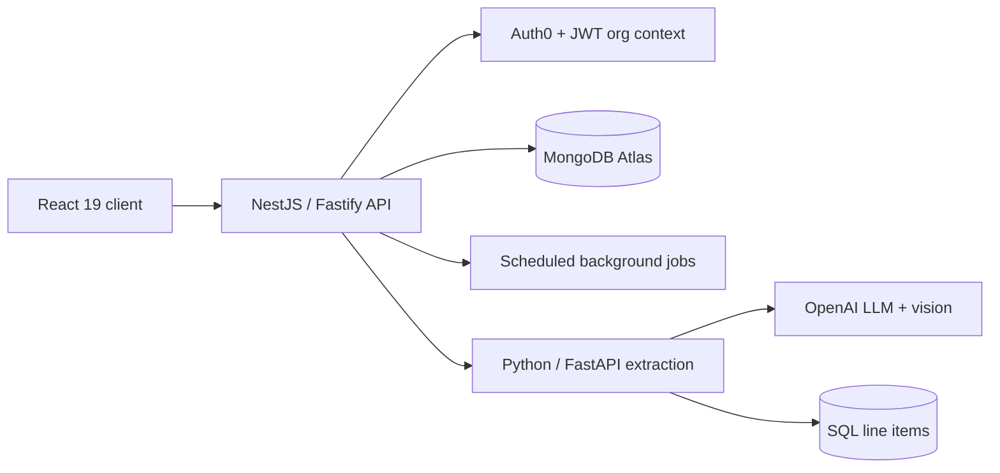
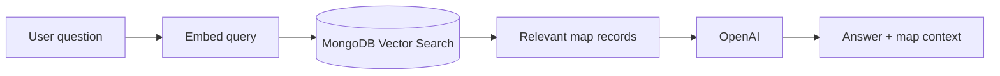

# Hi, I'm Maaz 👋

**Senior Full-Stack Developer** building AI, data and geospatial platforms. 4+ years shipping production systems with React, TypeScript, Node.js and NestJS, and leading the team that releases them.

📫 [LinkedIn](https://linkedin.com/in/maaz-javaid-a456ba1b8) · [Upwork](https://upwork.com/freelancers/~013be7c0a6bcab72a6) · mmaazj323@gmail.com

---

## 🧰 Stack

**Frontend:** React 19, Next.js, TypeScript, Redux, TanStack Query, Tailwind CSS, MUI
**Backend:** Node.js, NestJS, Fastify, Express, Python/FastAPI, Laravel, GraphQL, REST
**AI & Search:** OpenAI, RAG, MongoDB Vector Search, Elasticsearch, agentic workflows, LLM document extraction
**Data:** MongoDB Atlas, SQL Server, MySQL, Firestore
**Geospatial:** deck.gl, Mapbox GL
**Cloud & Security:** Azure, Key Vault, Auth0, JWT, RBAC, multi-tenant architecture

---

## 🔒 Work I can't open-source

Most of my commercial work lives in private repositories. Here's what I built and how. Happy to walk through the code and design decisions live.

### 1. Multi-tenant AI platform for real-asset data
*Lead engineer · NestJS, Fastify, MongoDB Atlas, Python/FastAPI, OpenAI, React 19, Azure*

- Architected a multi-tenant platform for documents, workflows and geospatial data, with tenant isolation through JWT organization context, NestJS guards and chat-session authorization.
- Built an LLM + vision extraction pipeline that turns PDFs, CSVs and spreadsheets into normalized SQL line items using parameter-safe batch inserts.
- Designed persistent AI-agent memory with automatic candidate detection, promotion workflows and scheduled, deduplicated discovery jobs.
- Led the platform team: owned release decisions and delivered 12+ milestones on schedule across 4 quarterly release cycles.

### 2. Geospatial intelligence & AI map assistant
*deck.gl, Mapbox, Elasticsearch, OpenAI, MongoDB Vector Search*

- Built deck.gl visualizations across 5+ configurable layer types, improving map render performance by 50%.
- Scaled Elasticsearch search over 1M+ records, cutting average query time by 45%.
- Shipped a RAG chat assistant over map data that cut manual querying by 60% and saves analysts ~3 hours a week.

### 3. Construction estimating platform (freelance)
*Next.js App Router, MongoDB, Vercel Blob, Plate.js*

- Built a production CMS-driven platform with admin auth, SEO metadata, dynamic routes and image uploads.
- Let non-technical users manage 6+ content types without developers or redeploys; 8+ custom Plate.js editor features cut editing time by ~30%.

---

## 📈 Elsewhere

- 10+ freelance engagements across 5+ countries: 100% 5-star rating, 100% on-time delivery
- B.S. Software Engineering, PUCIT
